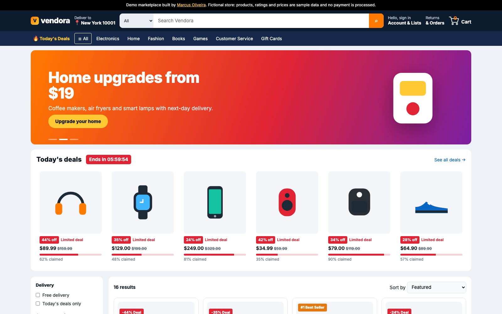

# Vendora Marketplace

E-commerce storefront in the style of large online marketplaces: search with live suggestions, departments, deals with countdown, filters, product page, cart and a 3-step checkout.

**Live demo:** https://marcusolive.github.io/vendora-marketplace/

> Portfolio project by [Marcus Oliveira](https://marcusolive.github.io). Vendora is a fictional store: products, ratings and prices are sample data and no payment is processed.



## Features

- Header with department selector, search box with live suggestions and highlighted matches
- Department navigation and "Today's Deals" shortcut
- Auto-rotating hero banners with calls to action
- Today's deals strip with discount badges, "% claimed" bars and a live countdown
- Filters: free delivery, deals only, minimum rating and maximum price; sorting by price, rating and discount
- Product cards with ratings, strike-through prices, savings, delivery date and low-stock warnings
- Product modal with buy box, quantity and "Buy now"
- Cart drawer with quantity controls, free-shipping progress bar, tax estimate
- 3-step checkout (cart, address, payment with card, PIX or PayPal) and order confirmation
- Keyboard support (`Esc` closes overlays) and responsive layout down to mobile

## Stack

HTML5, CSS3 and vanilla JavaScript, no dependencies and no build step. Product images are inline SVG illustrations, so the page loads fast.

## Project structure

```
index.html          markup
assets/css/app.css  styles
assets/js/app.js    catalog, filters, cart and checkout logic
docs/SPEC.md        functional specification
```

## Run locally

```bash
python3 -m http.server 8080
```

## Going to production

- Replace the in-memory catalog with an API (.NET, Node.js or a headless platform such as Shopify or WooCommerce)
- Connect checkout to Stripe, Mercado Pago, PayPal or PIX
- Add shipping quotes, order emails and ERP integration

## License

[MIT](LICENSE)
